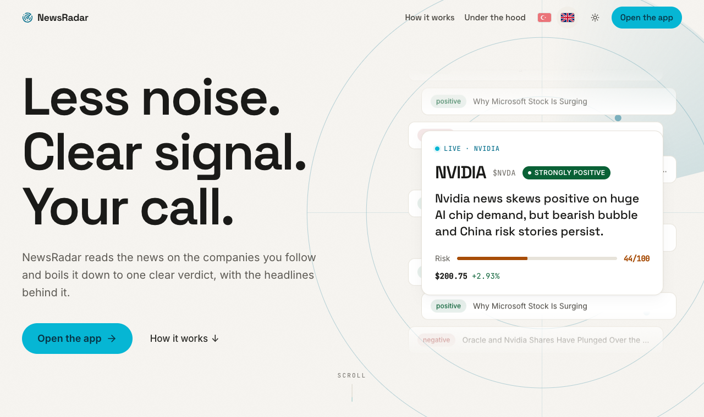
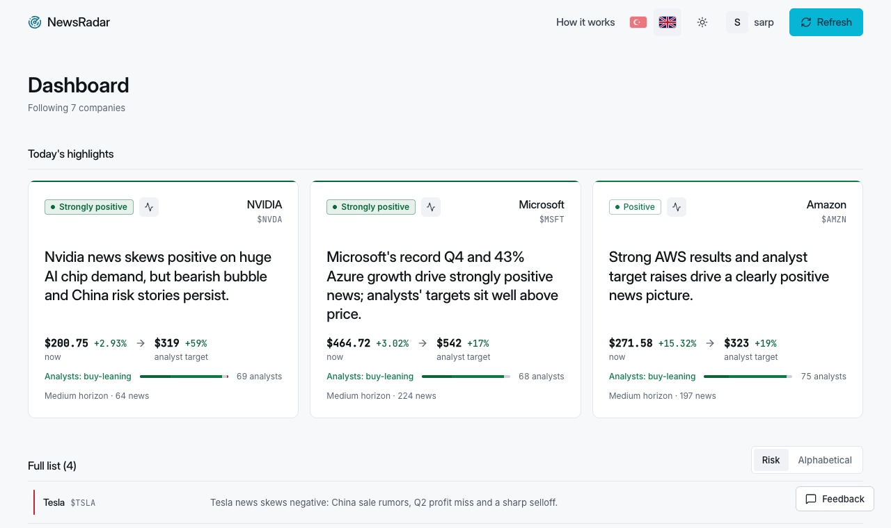
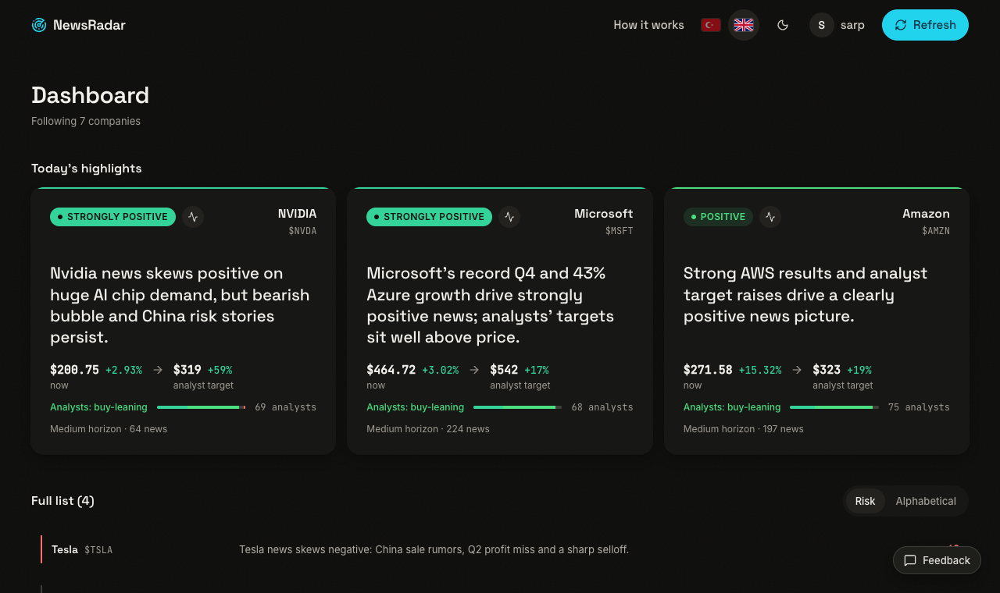
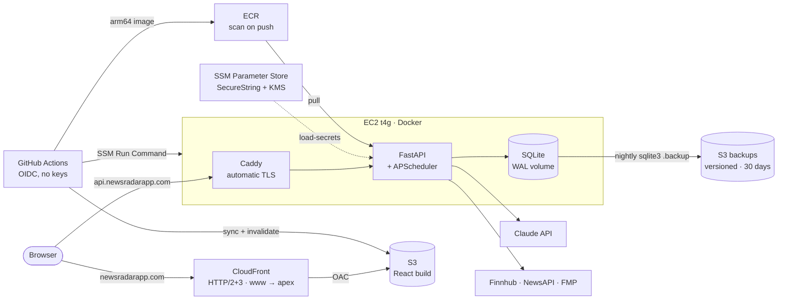

# NewsRadar 📡 — News-Based Stock Risk Analysis

**Live: [newsradarapp.com](https://newsradarapp.com)**. Free to try, no sign-up.

NewsRadar collects financial news for a watchlist of companies, has an LLM read and filter every article, and turns the results into a dashboard of risk scores, sentiment trends and a clear, reasoned verdict you can question in a chat. It works for public tickers and for private companies such as startups.

> Portfolio project.

| | Light theme | Dark theme |
|---|---|---|
| **Landing** |  |  |
| **App** |  |  |

> **Principle:** NewsRadar gives a clear direction (bullish / neutral / bearish) and a conviction level, but it keeps the **news-flow signal separate from price prediction**. It says explicitly what news cannot tell you (valuation, whether a move is already priced in), and every view includes a **"verify first" checklist**. There are no unexplained BUY/SELL calls. This is not investment advice.

---

## Features

- **Watchlist with two entity types:** `ticker` (public companies, news via Finnhub) and `keyword` (private companies and startups, news via NewsAPI), behind an interchangeable `NewsProvider` interface.
- **Scheduled ingestion:** an APScheduler job refreshes news automatically. Articles are de-duplicated by URL hash, so the same article is never analysed (or paid for) twice.
- **Two-level LLM analysis with structured output**
  - *Per article:* sentiment (−1..1), event type, risk flags, impact horizon, relevance and a short rationale. Off-topic articles are filtered out.
  - *Per entity:* risk score (0–100), sentiment trend, top 3 drivers, summary, stance and conviction, 2–4 "what to verify" points and an invalidation condition.
- **Chat with the news:** a streaming (SSE) chat with the latest articles of an entity as context.
- **Analyst consensus and price targets** (Finnhub / Financial Modeling Prep), shown next to the news signal.
- **Sprachen: Deutsch, English, Türkçe.** The interface, emails and AI analysis follow the user's language. The analysis is written once in English and translated (the verdict, risk and directions can't change in translation); the browser language picks the first language (de → German, tr → Turkish, otherwise English) and the user's choice always wins. All German strings live in one file, [`frontend/src/locales/de.json`](frontend/src/locales/de.json), so a German speaker can review them. German is currently switched off behind a flag (`NEWSRADAR_ENABLE_DE` / `VITE_ENABLE_DE`, default off); the code and translations stay in place.
- **Light / dark / system theme:** colours come from a single set of CSS variables. Both themes meet WCAG AA contrast, checked with axe on every screen.
- **Landing page** with a scroll-driven walkthrough built from real data and live numbers from a public stats endpoint. The dashboard lives at `/app` in its own bundle.
- **One design system for the landing page and the app:** shared tokens (colours, type scale, radii, motion) and shared components (buttons, chips, cards, inputs, tabs, modals, toasts), so moving from the landing page into the app feels like the same product.
- **Multi-user and cost-safe for a public site:**
  - Accounts and sessions: bcrypt passwords, signed session tokens, anonymous device sessions.
  - Spending limits: tiered per-user quotas and a system-wide **daily LLM budget in USD**.
  - **Admin panel** with usage, spend per model, cache hit rate and system health.
- **Cost controls:**
  - Every LLM call is recorded with its model and input / output / cache tokens, and priced from a per-model table.
  - Prompt caching on the system prompt and tool schemas.
  - Entity assessments are skipped when there is no new data.
- **Output quality guards:**
  - No user-facing field ends mid-sentence.
  - Boilerplate phrases are banned and retried once.
  - Every assessment is scanned for investment-advice wording.

## Tech stack

| Layer | Technologies |
|---|---|
| Backend | Python 3.14, FastAPI, SQLAlchemy, SQLite (WAL), APScheduler, Pydantic, bcrypt |
| LLM | **Anthropic Claude API** (`claude-haiku-5-5` for article analysis, entity assessments and chat; configurable per purpose) behind a provider abstraction |
| Data sources | Finnhub (ticker news, analyst recommendations), NewsAPI (keyword news), Financial Modeling Prep (price targets) |
| Frontend | React 18, Vite, Tailwind CSS (CSS-variable themes), Recharts |
| Infrastructure | AWS: EC2 (t4g, Docker + Caddy), S3 + CloudFront, ECR, Route 53, ACM, SSM Parameter Store, CloudWatch Logs |
| Delivery | GitHub Actions with OIDC (no stored AWS keys), SSM Run Command, automatic rollback |

## Architecture



Why each piece:

- **React + Vite + Tailwind.** A single-page app with a small landing bundle; the dashboard and charts load only on `/app`. Themes are CSS variables, so one class name works in both themes.
- **S3 + CloudFront with Origin Access Control.**
  - The bucket stays private: only this distribution can read it.
  - CloudFront handles HTTPS, HTTP/3, the `www` → apex redirect (a CloudFront Function) and SPA fallbacks.
  - Hashed assets are cached for a year; `index.html` is never cached.
- **FastAPI.** Pydantic models double as the LLM's structured-output schemas, and Server-Sent Events power the streaming chat.
- **SQLite in WAL mode on a Docker volume.** One small instance with one writer needs no database server. A nightly online backup goes to S3.
- **APScheduler in-process, one uvicorn worker.** Scheduled refreshes need no queue or extra service; one worker keeps the scheduler and SQLite single-process.
- **Claude API (Haiku).** Reliable tool-based structured output, prompt caching and low cost per article. A provider abstraction keeps an OpenAI-compatible fallback one environment variable away.
- **Caddy.**
  - Obtains and renews the API certificate automatically.
  - Adds security headers and caps request bodies.
  - Is the only proxy whose `X-Forwarded-For` the backend trusts, so a spoofed header cannot dodge rate limits.
- **EC2 t4g (arm64) + Docker.** Predictable cost and the same image locally and in production. The image is built natively on an arm64 runner.
- **SSM Parameter Store.** Secrets are encrypted with KMS and read by the instance role at deploy time. Nothing secret lives in the repo, the image or the AMI.
- **GitHub Actions + OIDC.** Short-lived credentials scoped to this repository's `main` branch, with separate least-privilege roles for backend and frontend.

Repository layout:

```
newsradar/
├── backend/            FastAPI + SQLite + APScheduler + LLM pipeline
│   ├── app/            config, db models, providers, analysis (prompts, schemas, price table,
│   │                   quality guards), api routes (incl. public stats), quotas, budget, security
│   ├── evals/          live evaluation scripts
│   ├── test_*.py       25 test suites (security audit, quotas, isolation, truncation, public API, …)
│   └── Dockerfile      python:3.14-slim, multi-stage, non-root, healthcheck
├── frontend/           React (Vite) + Tailwind + Recharts; landing at /, dashboard at /app
├── deploy/             docker-compose + Caddyfile, backup/restore/load-secrets/deploy scripts,
│                       IAM policies, AWS templates, local tests
├── docs/DEPLOY_AWS.md  step-by-step AWS runbook (setup, CI/CD, teardown, cost)
└── .github/workflows/  deploy-backend.yml, deploy-frontend.yml
```

## Deployment

Everything runs on AWS in `eu-central-1`. The setup is written down as a step-by-step runbook: **[docs/DEPLOY_AWS.md](docs/DEPLOY_AWS.md)**. Each step lists the commands, how to verify the result and what to do if it fails.

**AWS**

- **Compute: EC2 t4g.small.**
  - Amazon Linux 2023 on arm64, with an encrypted gp3 volume.
  - **IMDSv2 is required** and the hop limit is 1, so containers cannot reach the instance credentials.
- **Network.**
  - The security group allows only 80 and 443. **Port 22 is closed**; administration goes through **SSM Session Manager**.
  - An Elastic IP backs the `api` record.
- **DNS and TLS.**
  - Route 53 points the apex and `www` to CloudFront (alias records) and `api` to the Elastic IP.
  - ACM issues the CloudFront certificate; Caddy obtains the API certificate from Let's Encrypt.
- **Frontend: S3 + CloudFront + OAC.** Private bucket, HTTPS only, SPA error fallbacks, managed security headers.
- **Images: ECR.** Basic scanning on push; a lifecycle rule keeps the last 10 images.
- **Secrets: SSM Parameter Store** (SecureString, KMS), written into a `600` env file on the instance by `deploy/load-secrets.sh`.
- **Least-privilege IAM.**
  - The instance role reads only `/newsradar/prod/*`, writes only to `backups/` and pulls only its own ECR repository.
  - The only wildcards are actions that AWS does not allow to be scoped to a resource.
  - Policies live in [`deploy/iam/`](deploy/iam/).

**CI/CD (GitHub Actions + OIDC)**

- **Backend** ([`deploy-backend.yml`](.github/workflows/deploy-backend.yml)):
  1. All test suites, plus shellcheck and local tests for the deploy scripts.
  2. Native **arm64** build, pushed to ECR under the commit SHA only.
  3. Wait for the **ECR scan** and stop on any CRITICAL finding.
  4. Move the `prod` tag to the new image.
  5. **SSM Run Command** on the instance (`git pull`, load secrets, pull, restart, smoke test).
  6. If the smoke test fails, the instance **rolls back** to the previous image, the `prod` tag is restored and the workflow fails.
- **Frontend** ([`deploy-frontend.yml`](.github/workflows/deploy-frontend.yml)): build, then S3 sync (immutable assets first, `index.html` last), then CloudFront invalidation.

**Backups and monitoring**

- **Nightly backups** via a systemd timer:
  1. `sqlite3 .backup`
  2. `PRAGMA integrity_check`
  3. gzip
  4. Upload to S3 (versioned, 30-day lifecycle).
- **Restore:** `deploy/restore.sh` takes a local copy first, verifies the backup and restores the previous database automatically if the health check fails.
- **Logs:** container logs go to CloudWatch Logs, kept for 7 days.
- **Uptime:** **UptimeRobot** watches `https://api.newsradarapp.com/health`.

The whole setup costs roughly **$20 / month**; the runbook has the line items.

## Engineering notes: problems I ran into

- **Silently truncated LLM output.** Large article batches hit the output-token limit, so responses were cut off without an obvious error. The fix: a configurable batch size and output cap, plus automatic batch splitting when truncation is detected (`test_truncation.py`).
- **A relevance pre-filter that dropped Turkish articles.** Valid Turkish news was filtered out before it reached the analysis step; the filter now lets non-English articles through.
- **Templated LLM answers.** Example sentences in the system prompt made the model copy them almost word for word. Removing the examples fixed it.
- **Making a public LLM app affordable.**
  - Anyone can open the site, so costs are capped by per-user quotas, a daily USD budget and a per-IP limit on anonymous sessions.
  - A small model with prompt caching, and skipping assessments when nothing changed, brought a full five-company refresh (TR + EN) to a few cents.
- **Model output that looks fine until it doesn't.** Hard word caps cut verdicts mid-sentence, a model occasionally returned a list as a single string, and tool-call markup once leaked into a text field. Each case is now caught by an automated check.
- **Trusting the right client IP.** Rate limits keyed on `X-Forwarded-For` are easy to dodge. Caddy overwrites the header, and uvicorn trusts it only from Caddy's fixed container IP. An attacker-perspective test suite (`test_security_audit.py`) runs in both proxy modes.
- **Image scanning that silently did nothing.** BuildKit attaches provenance attestations by default, so ECR received an image index, and basic scanning returned `ScanNotFoundException`. Builds now use `--provenance=false --sbom=false`.
- **Accessibility debt in the original theme.** Measuring contrast for the dark theme showed that 25 colour pairs in the existing light theme were already below WCAG AA. Both palettes were tuned to pass, and text dimmed with `opacity` was replaced with real colour tokens.

## Running locally

### Backend

```bash
cd backend
python3 -m venv .venv && source .venv/bin/activate
pip install -r requirements.txt
cp .env.example .env        # add your API keys (see comments in the file)
python -m app.seed          # default watchlist
uvicorn app.api.main:app --reload    # http://localhost:8000 (API docs: /docs)
```

Step-by-step checks without the server:

```bash
python -m app.cli status          # provider keys + watchlist
python -m app.cli llm-check       # each configured model: access, tool use, caching, cost
python -m app.cli fetch TSLA      # fetch news for one entity
python -m app.cli analyze TSLA    # run the LLM analysis and print JSON
```

Tests (each script uses an isolated temporary database):

```bash
for t in test_*.py; do python "$t" || echo "FAILED: $t"; done
```

Live evaluation (real API calls, runs on a copy of the local database):

```bash
python -m evals.eval_refresh --db /tmp/nr_eval.db --out evals/reports/refresh.md
```

### Frontend

```bash
cd frontend
npm install
npm run dev                 # http://localhost:5173 (landing) · /app (dashboard)
```

If the backend runs elsewhere, set `VITE_API_URL` in `frontend/.env` (see `frontend/.env.example`).

### Docker (API + Caddy)

```bash
cd deploy && cp .env.example .env && docker compose up -d --build
```

Details and the ARM build: [deploy/README.md](deploy/README.md).

## How it was built

I built NewsRadar as a personal project with AI-assisted development (Claude). I defined the product and its features, worked through the architecture and trade-offs, and tested and debugged it in production. I'm a Business Information Systems (Wirtschaftsinformatik) student at Hochschule Furtwangen University.

**Sarp Bıçak** · [sarpbicak@gmail.com](mailto:sarpbicak@gmail.com) · [LinkedIn](https://www.linkedin.com/in/sarp-b%C4%B1%C3%A7ak-b5607037b/) · [GitHub](https://github.com/sarpbicak)

---

*NewsRadar is a news-flow signal tool, not financial advice. Always verify before acting.*
